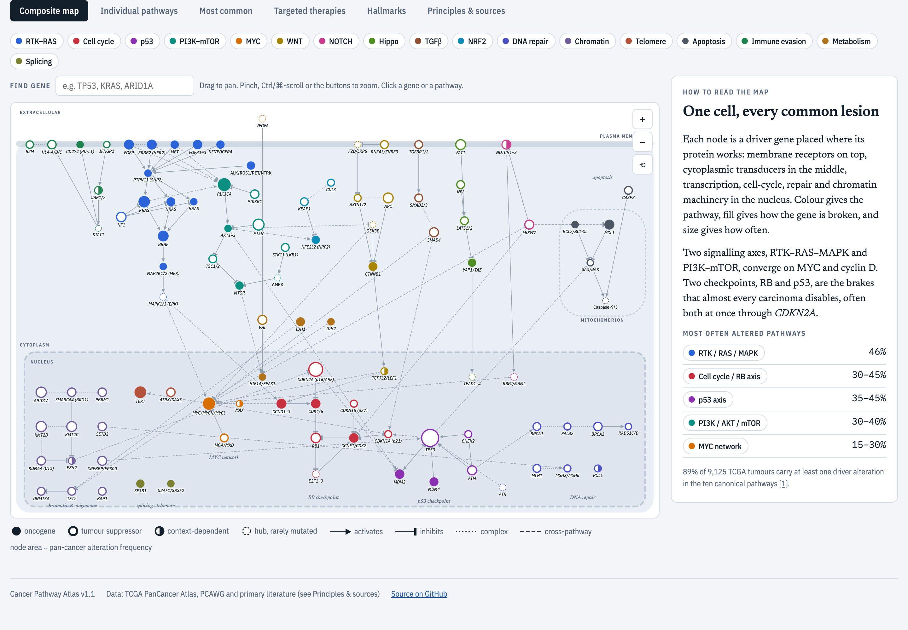
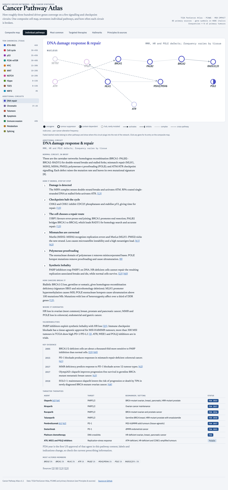
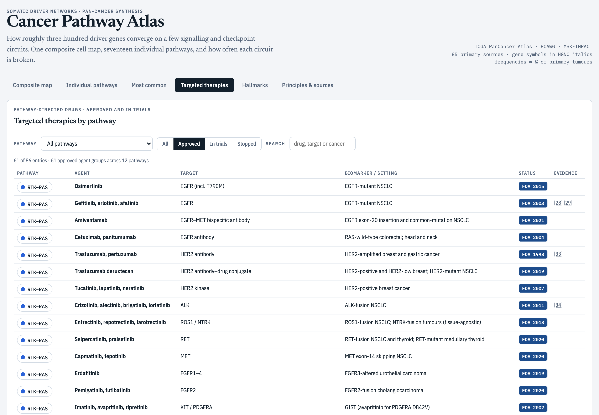
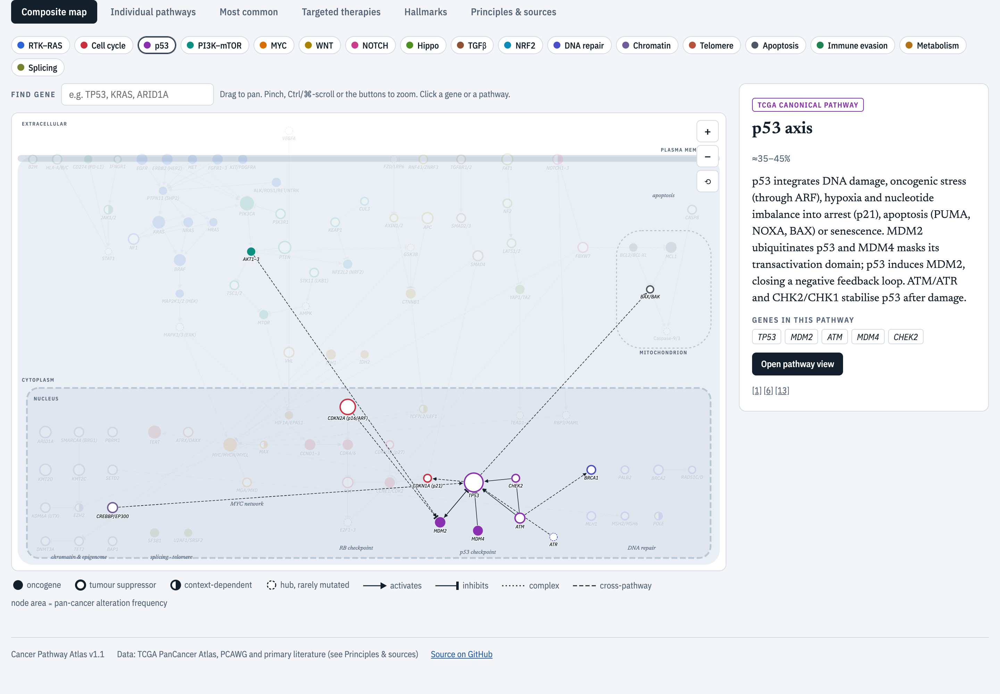
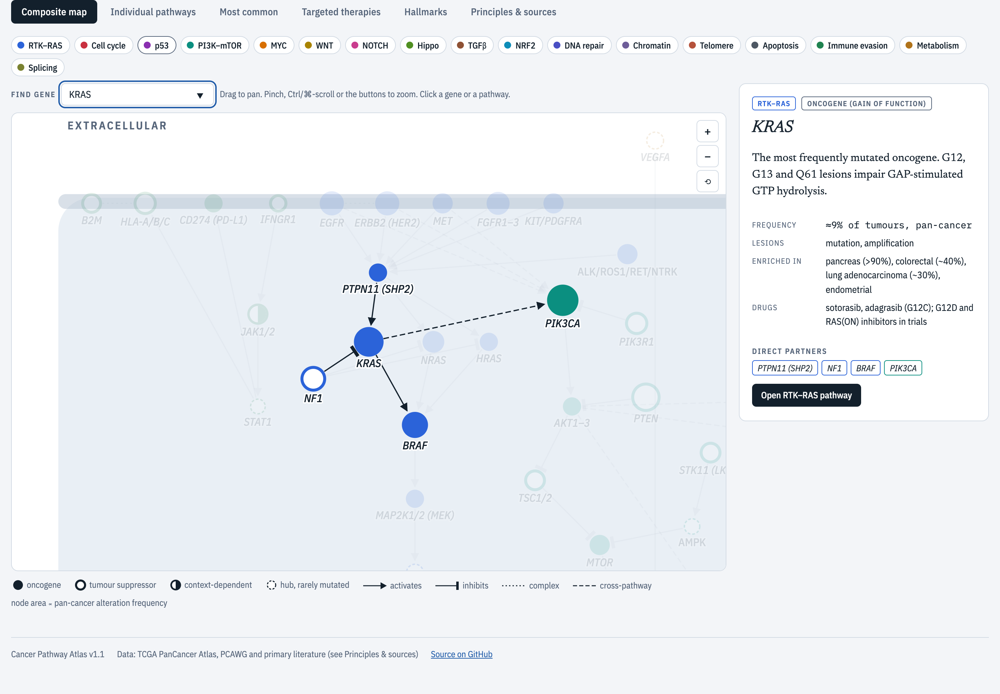
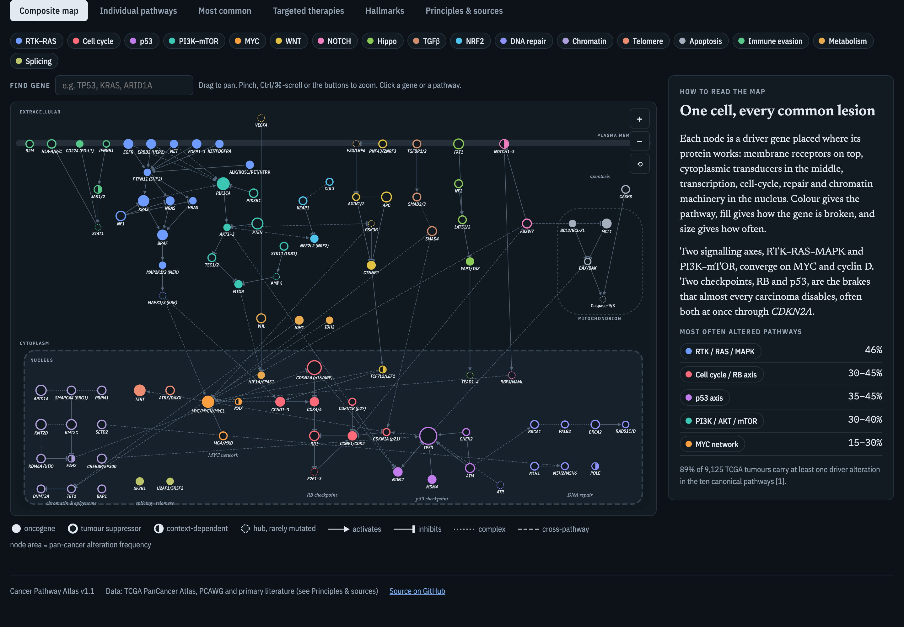
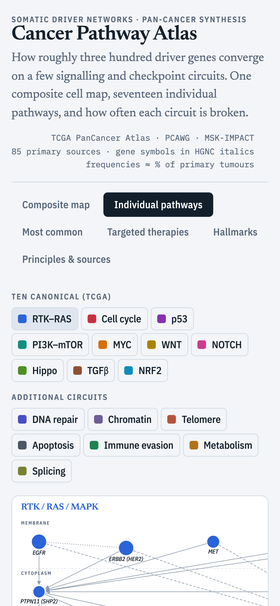

# Cancer Pathway Atlas

An interactive pan-cancer map of molecular driver lesions. It shows how roughly three hundred driver genes converge on a few signalling and checkpoint circuits, how each circuit works step by step, how often it is broken, and which targeted therapies act on it.

**Live site:** https://gsumathipala.github.io/cancer-pathway-atlas/



## What's inside

- **Composite map.** 99 driver genes placed in their cell compartments (membrane, cytoplasm, mitochondrion, nucleus) and 113 activating, inhibiting and complex interactions. Node size shows pan-cancer alteration frequency; fill shows oncogene, tumour suppressor, context-dependent or hub. Click a pathway to isolate it, or search or click a gene for its lesions, enriched cancers, drugs and partners.
- **17 pathway tutorials.** The ten TCGA canonical pathways (RTK–RAS, PI3K–mTOR, cell cycle/RB, p53, MYC, WNT, NOTCH, Hippo, TGFβ, NRF2) plus DNA repair, chromatin, telomere maintenance, apoptosis, immune evasion, metabolism/hypoxia and RNA splicing. Each has its own diagram, a numbered walk-through of the normal circuit with a citation on every step, how cancers break it, where it dominates, a timeline of key evidence, and a targeted-therapy table.
- **Most common.** Pathway and gene alteration frequencies, plus a pathway × tumour-type matrix for 18 cancers.
- **Targeted therapies.** 86 entries (61 FDA-approved agent groups across 12 pathways, plus agents in trials and stopped programmes), filterable by pathway, status and free text.
- **Hallmarks.** Each pathway mapped onto the 14 hallmark capabilities and enabling characteristics (Hanahan 2022).
- **Principles & sources.** Ten organising principles and all 85 primary sources, each checked in PubMed and linked by DOI.

| Pathway tutorial | Targeted therapies |
|---|---|
|  |  |

| p53 focus | Gene detail | Dark mode | Phone |
|---|---|---|---|
|  |  |  |  |

More: [pathway view](docs/screenshots/04-pathway-rtk.png) · [frequencies](docs/screenshots/06-most-common.png) · [hallmarks](docs/screenshots/08-hallmarks.png)

## Run it locally

Needs only Python 3.9 or newer. There are no dependencies to install, and D3 is vendored so it works offline.

```sh
python3 server.py            # http://127.0.0.1:8000
python3 server.py --open     # also opens your browser
PORT=8080 python3 server.py --host 0.0.0.0
```

With Docker:

```sh
docker build -t cancer-pathway-atlas .
docker run -p 8000:8000 cancer-pathway-atlas
```

The `docs/` folder is also a complete static site, which is how GitHub Pages serves it.

## JSON API

The server exposes the atlas data read-only:

| Endpoint | Returns |
|---|---|
| `GET /api/health` | status and counts |
| `GET /api/pathways` | all pathways with frequency, gene and approved-drug counts |
| `GET /api/pathways/{id}` | one pathway with tutorial steps, evidence, therapies and genes (`rtk`, `pi3k`, `cc`, `p53`, `myc`, `wnt`, `notch`, `hippo`, `tgfb`, `nrf2`, `ddr`, `chrom`, `telo`, `apop`, `immune`, `metab`, `splice`) |
| `GET /api/genes?pathway={id}` | genes, optionally filtered |
| `GET /api/genes/{symbol}` | one gene with interaction partners; aliases such as `HER2` resolve |
| `GET /api/edges` | the interaction network |
| `GET /api/therapies?pathway={id}&status=approved\|trials\|stopped` | therapy records |
| `GET /api/search?q={text}` | genes, pathways and therapies matching the text |
| `GET /api/references` | numbered citations with DOIs |

```sh
curl -s localhost:8000/api/genes/KRAS
curl -s 'localhost:8000/api/therapies?pathway=ddr&status=approved'
```

## Tests

```sh
python3 -m unittest discover -s tests -v
```

## Data and caveats

All content lives in [`docs/data.json`](docs/data.json). Pathway frequencies come from Sanchez-Vega et al., *Cell* 2018: RTK–RAS (46% median) and NRF2 (4%) are stated in that paper; the other pathway values are shown as estimated ranges because the paper gives them only in figures. Gene-level percentages are rounded guides drawn from TCGA PanCancer and PCAWG studies, not point estimates; use [cBioPortal](https://www.cbioportal.org) for exact counts. Most of the underlying cohorts are primary tumours, which under-represents metastatic, paediatric, haematological and non-European-ancestry cancers.

FDA years give the first US approval of each agent, or group of agents, in that pathway context. Indications change, so check current prescribing information. This is an educational reference, not clinical guidance.

## Licence

All rights reserved; see [LICENSE](LICENSE). D3.js is included under its ISC licence.
